# Klasifikácia obrazov lesného požiaru, dymu a neprítomnosti požiaru

[](https://www.python.org/)
[](https://pytorch.org/)
[](#dataset-a-rozdelenie-dat)
[](#protokol-trenovania)
[](#modely)

Tento repozitár obsahuje reprodukovateľné porovnanie transferového učenia pre predmet **Hlboké neurónové siete (HNS)** na STU FEI. Porovnáva päť architektúr pri klasifikácii obrázkov do tried `Fire`, `Smoke` a `Non_Fire`.

## Zhrnutie zadania

Zadanie vyžaduje porovnať klasickú CNN, CNN s attention vrstvou, optimalizovanú CNN, vizuálny transformer a hybridný model pomocou transferového učenia. Dataset sa náhodne rozdelí na tréningovú, validačnú a testovaciu množinu v pomere 80 % / 10 % / 10 %. Každý model sa má natrénovať trikrát a výsledky sa majú štatisticky vyhodnotiť.

Pre najlepší checkpoint každého typu modelu je potrebné ukázať krivky Loss a Accuracy pre trénovacie a validačné dáta, metriky Accuracy, Precision a Recall na testovacích dátach, maticu zámien a vizualizáciu rozhodovania CNN pomocou Grad-CAM. Aspoň pri jednom modeli sa má ukázať vplyv augmentácie a postupného rozmrazovania vrstiev.

---

## Obsah

- [Zhrnutie zadania](#zhrnutie-zadania)
- [Ciele](#ciele)
- [Dataset a rozdelenie dát](#dataset-a-rozdelenie-dat)
- [Modely](#modely)
- [Protokol trénovania](#protokol-trenovania)
- [Výsledky](#vysledky)
- [Najlepší checkpoint každého typu modelu](#najlepsi-checkpoint-kazdeho-typu-modelu)
- [Podrobné výsledky modelov](#podrobne-vysledky-modelov)
- [Doplnkové experimenty M1](#doplnkove-experimenty-m1-augmentacia-a-rozmrazovanie)
- [Grad-CAM vizualizácie](#grad-cam-vizualizacie)
- [Doplnkové hodnotenie na kompletných pôvodných testovacích dátach](#doplnkove-hodnotenie-na-kompletnych-povodnych-testovacich-datach)
- [Výstupy programu](#vystupy-programu)
- [Inštalácia](#instalacia)
- [Spustenie](#spustenie)
- [Autori](#autori)

---

### Zoznam obrázkov

1. [Obrázok 1. Krivky učenia M1 - ResNet50](#fig-m1-history-sk)
2. [Obrázok 2. Matica zámien M1 - ResNet50](#fig-m1-cm-sk)
3. [Obrázok 3. Krivky učenia M2 - ResNet50 + CBAM](#fig-m2-history-sk)
4. [Obrázok 4. Matica zámien M2 - ResNet50 + CBAM](#fig-m2-cm-sk)
5. [Obrázok 5. Krivky učenia M3 - ConvNeXt-Tiny](#fig-m3-history-sk)
6. [Obrázok 6. Matica zámien M3 - ConvNeXt-Tiny](#fig-m3-cm-sk)
7. [Obrázok 7. Krivky učenia M4 - ViT-Tiny](#fig-m4-history-sk)
8. [Obrázok 8. Matica zámien M4 - ViT-Tiny](#fig-m4-cm-sk)
9. [Obrázok 9. Krivky učenia M5 - CoAtNet-0](#fig-m5-history-sk)
10. [Obrázok 10. Matica zámien M5 - CoAtNet-0](#fig-m5-cm-sk)
11. [Obrázok 11. M1 bez doplnkovej augmentácie](#fig-m1-no-augmentation-sk)
12. [Obrázok 12. M1 so zmrazeným backbone](#fig-m1-frozen-sk)
13. [Obrázok 13. Grad-CAM: správna predikcia M1](#fig-gradcam-correct-sk)
14. [Obrázok 14. Grad-CAM: nesprávna predikcia M1](#fig-gradcam-incorrect-sk)
15. [Obrázok 15. M5 na kompletných pôvodných testovacích dátach](#fig-m5-full-test-cm-sk)

---

### Zoznam tabuliek

1. [Tabuľka 1. Pevné stratifikované rozdelenie](#tbl-split-sk)
2. [Tabuľka 2. Spoločná konfigurácia transferového učenia](#tbl-configuration-sk)
3. [Tabuľka 3. Priemerné testovacie metriky z troch behov](#tbl-average-results-sk)
4. [Tabuľka 4. Checkpointy vybrané podľa validation loss](#tbl-best-checkpoints-sk)
5. [Tabuľka 5. Podrobné výsledky M1](#tbl-m1-sk)
6. [Tabuľka 6. Podrobné výsledky M2](#tbl-m2-sk)
7. [Tabuľka 7. Podrobné výsledky M3](#tbl-m3-sk)
8. [Tabuľka 8. Podrobné výsledky M4](#tbl-m4-sk)
9. [Tabuľka 9. Podrobné výsledky M5](#tbl-m5-sk)
10. [Tabuľka 10. Doplnkové experimenty M1](#tbl-additional-m1-sk)
11. [Tabuľka 11. Hodnotenie kompletných pôvodných testovacích dát](#tbl-full-test-sk)

---

## Ciele

Projekt:

1. vytvorí jedno reprodukovateľné stratifikované rozdelenie 80 % / 10 % / 10 %;
2. porovná CNN, CNN s attention, optimalizovanú CNN, vision transformer a hybridný model;
3. opakuje hlavný experiment trikrát pre každý model a uvádza priemer aj smerodajnú odchýlku;
4. vyhodnocuje oddelené testovacie dáta pomocou Accuracy, macro Precision, macro Recall, macro F1-score a matíc zámien;
5. vytvára krivky učenia a Grad-CAM vysvetlenia;
6. skúma augmentáciu a fine-tuning pri základnom CNN modeli.

<p align="right"><a href="#obsah">Späť na obsah</a></p>

---

## Dataset a rozdelenie dát

Dataset: [Forest Fire Smoke and Non-Fire Image Dataset](https://www.kaggle.com/datasets/amerzishminha/forest-fire-smoke-and-non-fire-image-dataset)

Zdrojový dataset bol organizovaný v priečinkoch pre `Fire`, `Smoke` a `Non_Fire`/`non fire`. Obsahoval obrázky vo formátoch JPG/JPEG, PNG, BMP, WEBP a TIFF. Pôvodný dataset mal viac ako 14 000 obrázkov na triedu naprieč dodanými priečinkami. Pôvodné priečinky `train` a `test` neboli použité ako konečné experimentálne rozdelenie: skript najprv zhromaždil všetky obrázky a potom vytvoril nové rozdelenie požadované zadaním.

Pre vyvážené a výpočtovo zvládnuteľné porovnanie sa náhodne vybralo **1 000 obrázkov z každej triedy**. Tento postup zodpovedá príkladu 1 000 vzoriek na triedu v zadaní. Umožňuje spravodlivé zastúpenie tried a spustenie piatich modelov trikrát aj na CPU. Výber aj rozdelenie používajú seed `42` a zapisujú sa do `splits/manifest.csv`.

Po hlavnom porovnaní bol vybraný checkpoint M5 dodatočne vyhodnotený na všetkých **10 500 obrázkoch** v pôvodných testovacích priečinkoch datasetu, teda 3 500 obrázkov na triedu. Ide o doplnkový experiment uvedený na konci dokumentu; nepoužíva sa pri výbere modelu ani v hlavnom porovnaní.

<a id="tbl-split-sk"></a>

**Tabuľka 1. Pevné stratifikované rozdelenie použité pre každý model a beh.**

| Časť | Fire | Smoke | Non_Fire | Spolu |
|---|---:|---:|---:|---:|
| Train | 800 | 800 | 800 | 2 400 |
| Validation | 100 | 100 | 100 | 300 |
| Test | 100 | 100 | 100 | 300 |

Všetky modely a všetky opakované behy používajú úplne rovnaké rozdelenie. Trénovacie seedy ovplyvňujú iba náhodnú inicializáciu novej klasifikačnej vrstvy, poradie batchov a náhodné augmentácie; nemenia rozdelenie dát.

Základ vytvorenia rozdelenia je nasledujúci. `groupby(...).sample(...)` vyberie rovnaký počet vzoriek z každej triedy a dve volania so `stratify` zachovajú podiel tried vo všetkých podmnožinách.

```python
frame = frame.groupby("label", group_keys=False).sample(
    n=samples_per_class, random_state=seed
).reset_index(drop=True)

train, holdout = train_test_split(
    frame, test_size=0.2, random_state=seed, stratify=frame.label
)
valid, test = train_test_split(
    holdout, test_size=0.5, random_state=seed, stratify=holdout.label
)
```

<p align="right"><a href="#obsah">Späť na obsah</a></p>

---

## Modely

| ID | Model | Kategória |
|---|---|---|
| M1 | ResNet50 | Základná CNN |
| M2 | ResNet50 + CBAM | CNN s channel a spatial attention |
| M3 | ConvNeXt-Tiny | Optimalizovaná CNN |
| M4 | ViT-Tiny | Vizuálny transformer |
| M5 | CoAtNet-0 | Hybridný konvolučný-attention model |

Všetky modely používajú predtrénované ImageNet váhy. Pôvodná klasifikačná vrstva bola nahradená novou hlavou pre tri triedy.

<p align="right"><a href="#obsah">Späť na obsah</a></p>

---

## Protokol trénovania

<a id="tbl-configuration-sk"></a>

**Tabuľka 2. Spoločná konfigurácia transferového učenia.**

| Parameter | Použité nastavenie |
|---|---|
| Veľkosť vstupu | 224 x 224 pixelov |
| Optimizer | AdamW |
| Počiatočný learning rate | 0,0003 |
| Weight decay | 0,0001 |
| Batch size | 8 |
| Maximálny počet epoch | 15 |
| Early stopping | patience validation loss = 4 |
| Hlavné behy na model | 3 |

Na začiatku je trénovateľná iba nová klasifikačná hlava. Pri konfigurácii s 15 epochami sa pred epochou 5 rozmrazia všetky vrstvy a learning rate sa zníži z `0.0003` na `0.00003`. Najlepší checkpoint je vybraný iba podľa najnižšieho validation loss. Testovacie dáta sa používajú len na konečné vyhodnotenie.

### Predspracovanie a augmentácia

Trénovacie obrázky sa najprv zmenia na 256 x 256 pixelov a potom sa použije:

- `RandomResizedCrop(224, scale=(0.75, 1.0))`;
- horizontálne prevrátenie s pravdepodobnosťou 0,5;
- náhodná rotácia od -12 do +12 stupňov;
- `ColorJitter(0.15, 0.15, 0.1)` pre miernu zmenu jasu, kontrastu a sýtosti;
- konverzia na tensor a ImageNet normalizácia.

Validačné a testovacie obrázky používajú iba deterministické predspracovanie: resize, center crop, konverziu na tensor a normalizáciu. Na validačných ani testovacích dátach sa nepoužíva náhodná augmentácia.

<p align="right"><a href="#obsah">Späť na obsah</a></p>

---

## Výsledky

Tabuľka uvádza priemer ± smerodajnú odchýlku z troch hlavných behov. Macro metriky sa najprv vypočítajú samostatne pre `Fire`, `Smoke` a `Non_Fire`, potom má každá trieda rovnakú váhu.

<a id="tbl-average-results-sk"></a>

**Tabuľka 3. Priemerné testovacie metriky z troch opakovaných behov.**

| Model | Accuracy | Precision macro | Recall macro | F1 macro |
|---|---:|---:|---:|---:|
| M1 - ResNet50 | 97,89 % ± 0,51 % | 97,93 % ± 0,50 % | 97,89 % ± 0,51 % | 97,89 % ± 0,51 % |
| M2 - ResNet50 + CBAM | 97,67 % ± 0,88 % | 97,75 % ± 0,78 % | 97,67 % ± 0,88 % | 97,67 % ± 0,87 % |
| M3 - ConvNeXt-Tiny | 99,00 % ± 0,33 % | 99,01 % ± 0,33 % | 99,00 % ± 0,33 % | 99,00 % ± 0,33 % |
| M4 - ViT-Tiny | 97,89 % ± 0,84 % | 97,92 % ± 0,84 % | 97,89 % ± 0,84 % | 97,89 % ± 0,84 % |
| M5 - CoAtNet-0 | **99,33 % ± 0,67 %** | **99,34 % ± 0,65 %** | **99,33 % ± 0,67 %** | **99,33 % ± 0,67 %** |

### Záver hlavných výsledkov

- **CoAtNet-0 (M5)** dosiahol najvyššiu priemernú testovaciu accuracy: **99,33 %**.
- **ConvNeXt-Tiny (M3)** bol najstabilnejší model s najnižšou smerodajnou odchýlkou: **0,33 %**.
- Najlepší jednotlivý beh M5 klasifikoval správne všetkých 300 testovacích obrázkov. Neznamená to zaručenú 100 % úspešnosť v reálnom prostredí.
- M1 so zmrazeným backbone dosiahol 94,33 %, zatiaľ čo hlavná konfigurácia M1 s fine-tuningom dosiahla priemerne 97,89 %. Fine-tuning predtrénovaných vrstiev bol pre túto úlohu dôležitý.

<p align="right"><a href="#obsah">Späť na obsah</a></p>

---

## Najlepší checkpoint každého typu modelu

Checkpoint sa vyberá podľa **najnižšieho validation loss**, ešte pred kontrolou konečných testovacích metrík. Preto môže mať zvolený beh nižšiu testovaciu accuracy ako iný beh rovnakého modelu; je to metodicky správne, pretože testovacie dáta sa nesmú používať na výber modelu.

<a id="tbl-best-checkpoints-sk"></a>

**Tabuľka 4. Checkpointy vybrané podľa najnižšieho validation loss.**

| Model | Vybraný beh | Test accuracy | Precision macro | Recall macro | F1 macro | Najlepší validation loss | Epochy |
|---|---:|---:|---:|---:|---:|---:|---:|
| M1 - ResNet50 | 3 | 98,00 % | 98,03 % | 98,00 % | 98,00 % | 0,05314 | 14 |
| M2 - ResNet50 + CBAM | 3 | 98,00 % | 98,03 % | 98,00 % | 98,00 % | 0,06747 | 12 |
| M3 - ConvNeXt-Tiny | 3 | 99,33 % | 99,33 % | 99,33 % | 99,33 % | 0,06546 | 10 |
| M4 - ViT-Tiny | 2 | 97,00 % | 97,02 % | 97,00 % | 97,00 % | 0,04082 | 15 |
| M5 - CoAtNet-0 | 3 | 100,00 % | 100,00 % | 100,00 % | 100,00 % | 0,03852 | 10 |

<p align="right"><a href="#obsah">Späť na obsah</a></p>

---

## Podrobné výsledky modelov

Všetky hodnoty v nasledujúcich tabuľkách sú vypočítané na rovnakej oddelenej testovacej množine 300 obrázkov. `Validation loss` je najnižšia hodnota dosiahnutá počas behu a používa sa pri výbere checkpointu. Hlavné behy používajú augmentáciu aj rozmrazovanie backbone.

### M1 - ResNet50
<a id="tbl-m1-sk"></a>

**Tabuľka 5. Testovacie výsledky jednotlivých behov ResNet50.**

| Beh | Accuracy | Precision macro | Recall macro | F1 macro | Validation loss | Epochy |
|---:|---:|---:|---:|---:|---:|---:|
| 1 | 98,33 % | 98,38 % | 98,33 % | 98,33 % | 0,05687 | 11 |
| 2 | 97,33 % | 97,38 % | 97,33 % | 97,33 % | 0,07382 | 15 |
| 3 | 98,00 % | 98,03 % | 98,00 % | 98,00 % | 0,05314 | 14 |
| **Priemer ± odchýlka** | **97,89 % ± 0,51 %** | **97,93 % ± 0,50 %** | **97,89 % ± 0,51 %** | **97,89 % ± 0,51 %** | - | - |

<a id="fig-m1-history-sk"></a>
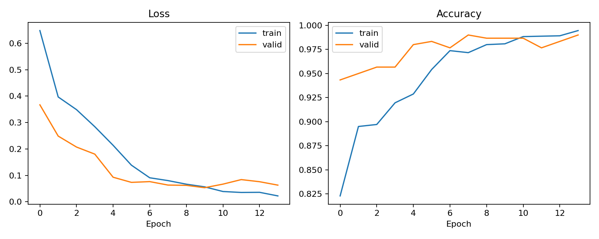

*Obrázok 1. Trénovací a validačný loss a accuracy vybraného behu ResNet50 (M1, beh 3).*

<a id="fig-m1-cm-sk"></a>
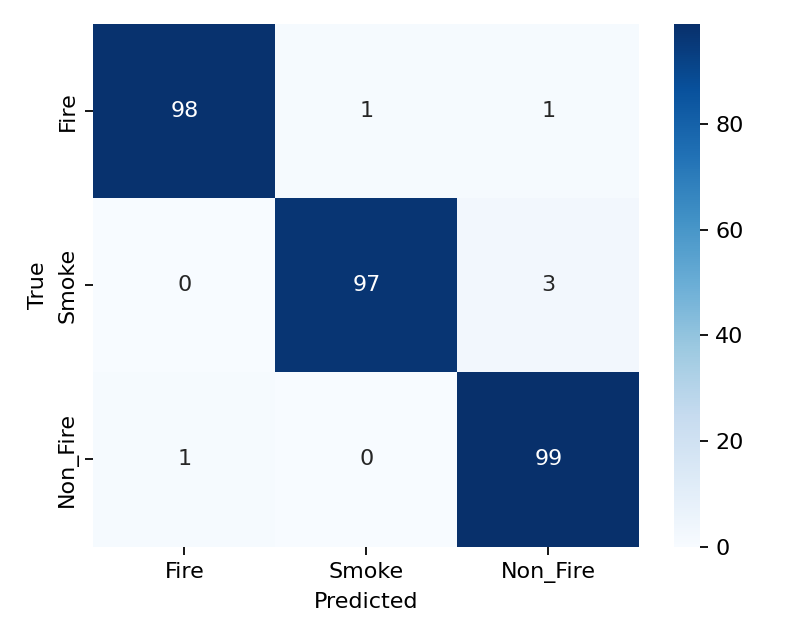

*Obrázok 2. Matica zámien na testovacích dátach pre vybraný beh ResNet50 (M1, beh 3).*

### M2 - ResNet50 + CBAM
<a id="tbl-m2-sk"></a>

**Tabuľka 6. Testovacie výsledky jednotlivých behov ResNet50 + CBAM.**

| Beh | Accuracy | Precision macro | Recall macro | F1 macro | Validation loss | Epochy |
|---:|---:|---:|---:|---:|---:|---:|
| 1 | 96,67 % | 96,87 % | 96,67 % | 96,69 % | 0,08093 | 12 |
| 2 | 98,33 % | 98,35 % | 98,33 % | 98,33 % | 0,07108 | 12 |
| 3 | 98,00 % | 98,03 % | 98,00 % | 98,00 % | 0,06747 | 12 |
| **Priemer ± odchýlka** | **97,67 % ± 0,88 %** | **97,75 % ± 0,78 %** | **97,67 % ± 0,88 %** | **97,67 % ± 0,87 %** | - | - |

<a id="fig-m2-history-sk"></a>
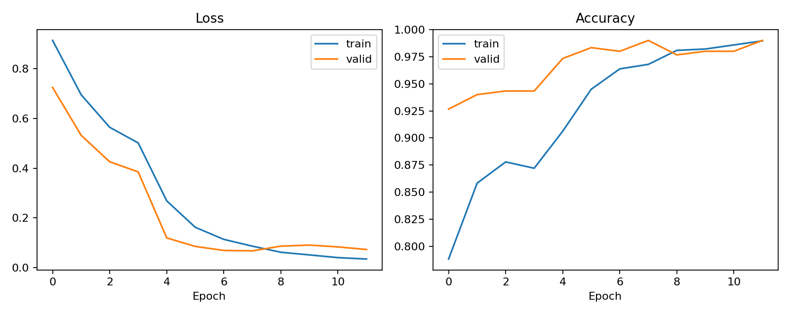

*Obrázok 3. Trénovací a validačný loss a accuracy vybraného behu ResNet50 + CBAM (M2, beh 3).*

<a id="fig-m2-cm-sk"></a>
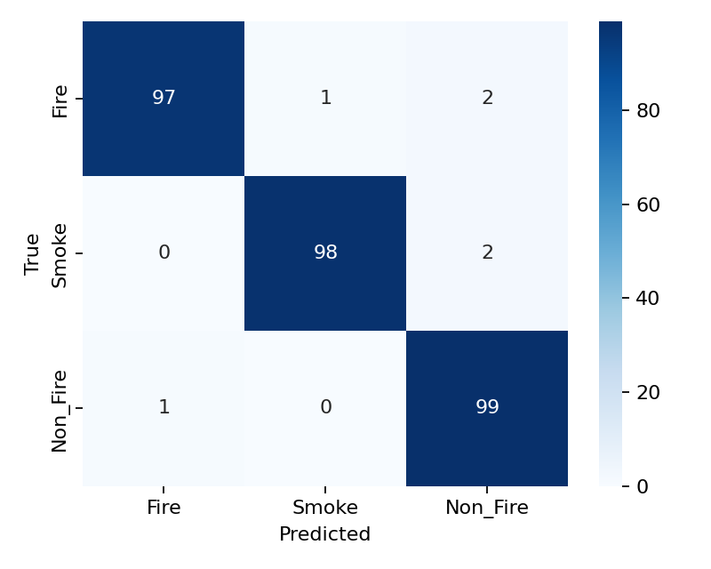

*Obrázok 4. Matica zámien na testovacích dátach pre vybraný beh ResNet50 + CBAM (M2, beh 3).*

### M3 - ConvNeXt-Tiny
<a id="tbl-m3-sk"></a>

**Tabuľka 7. Testovacie výsledky jednotlivých behov ConvNeXt-Tiny.**

| Beh | Accuracy | Precision macro | Recall macro | F1 macro | Validation loss | Epochy |
|---:|---:|---:|---:|---:|---:|---:|
| 1 | 99,00 % | 99,00 % | 99,00 % | 99,00 % | 0,06756 | 12 |
| 2 | 98,67 % | 98,68 % | 98,67 % | 98,67 % | 0,07283 | 10 |
| 3 | 99,33 % | 99,33 % | 99,33 % | 99,33 % | 0,06546 | 10 |
| **Priemer ± odchýlka** | **99,00 % ± 0,33 %** | **99,01 % ± 0,33 %** | **99,00 % ± 0,33 %** | **99,00 % ± 0,33 %** | - | - |

<a id="fig-m3-history-sk"></a>
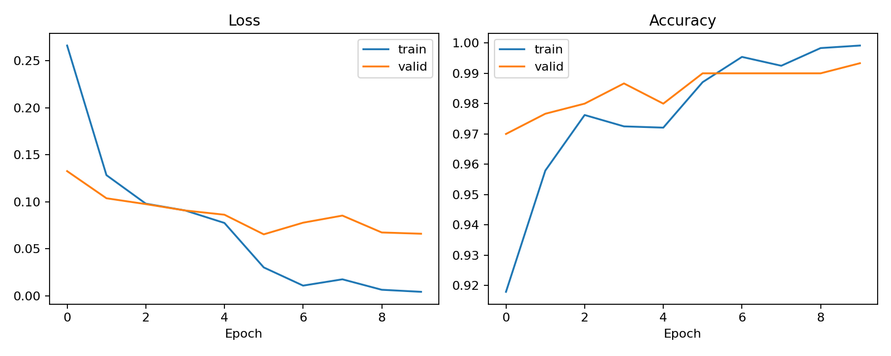

*Obrázok 5. Trénovací a validačný loss a accuracy vybraného behu ConvNeXt-Tiny (M3, beh 3).*

<a id="fig-m3-cm-sk"></a>


*Obrázok 6. Matica zámien na testovacích dátach pre vybraný beh ConvNeXt-Tiny (M3, beh 3).*

### M4 - ViT-Tiny
<a id="tbl-m4-sk"></a>

**Tabuľka 8. Testovacie výsledky jednotlivých behov ViT-Tiny.**

| Beh | Accuracy | Precision macro | Recall macro | F1 macro | Validation loss | Epochy |
|---:|---:|---:|---:|---:|---:|---:|
| 1 | 98,00 % | 98,06 % | 98,00 % | 98,01 % | 0,05506 | 12 |
| 2 | 97,00 % | 97,02 % | 97,00 % | 97,00 % | 0,04082 | 15 |
| 3 | 98,67 % | 98,67 % | 98,67 % | 98,67 % | 0,05865 | 13 |
| **Priemer ± odchýlka** | **97,89 % ± 0,84 %** | **97,92 % ± 0,84 %** | **97,89 % ± 0,84 %** | **97,89 % ± 0,84 %** | - | - |

<a id="fig-m4-history-sk"></a>
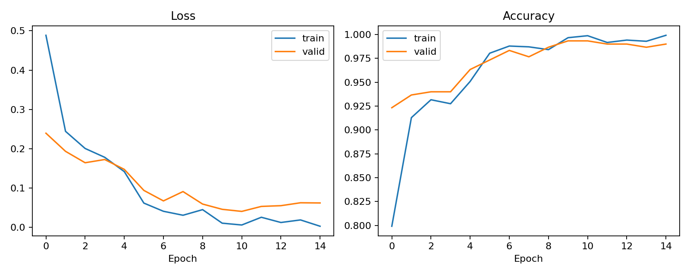

*Obrázok 7. Trénovací a validačný loss a accuracy vybraného behu ViT-Tiny (M4, beh 2).*

<a id="fig-m4-cm-sk"></a>
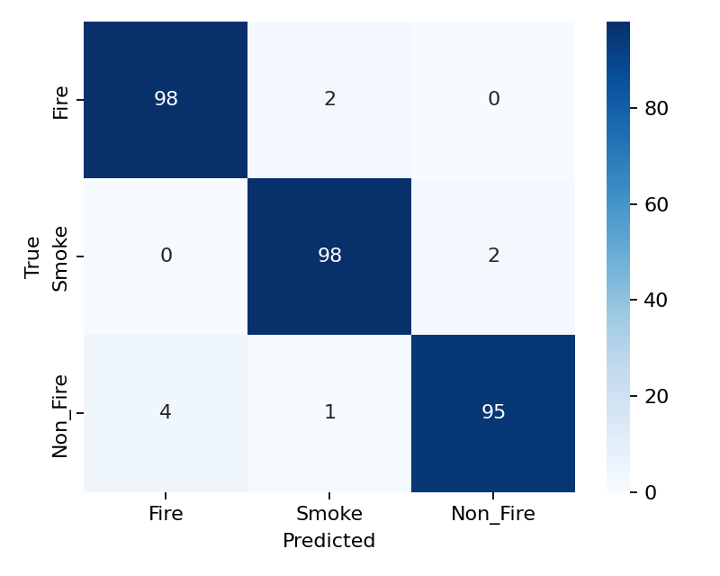

*Obrázok 8. Matica zámien na testovacích dátach pre vybraný beh ViT-Tiny (M4, beh 2).*

### M5 - CoAtNet-0
<a id="tbl-m5-sk"></a>

**Tabuľka 9. Testovacie výsledky jednotlivých behov CoAtNet-0.**

| Beh | Accuracy | Precision macro | Recall macro | F1 macro | Validation loss | Epochy |
|---:|---:|---:|---:|---:|---:|---:|
| 1 | 98,67 % | 98,69 % | 98,67 % | 98,67 % | 0,06188 | 9 |
| 2 | 99,33 % | 99,34 % | 99,33 % | 99,33 % | 0,05054 | 11 |
| 3 | 100,00 % | 100,00 % | 100,00 % | 100,00 % | 0,03852 | 10 |
| **Priemer ± odchýlka** | **99,33 % ± 0,67 %** | **99,34 % ± 0,65 %** | **99,33 % ± 0,67 %** | **99,33 % ± 0,67 %** | - | - |

<a id="fig-m5-history-sk"></a>
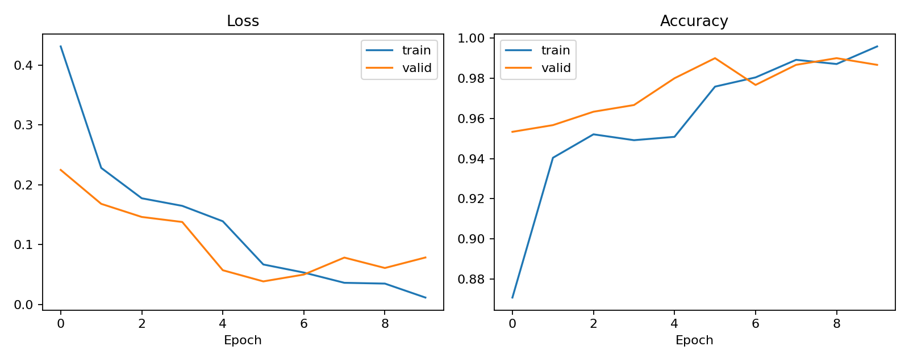

*Obrázok 9. Trénovací a validačný loss a accuracy vybraného behu CoAtNet-0 (M5, beh 3).*

<a id="fig-m5-cm-sk"></a>
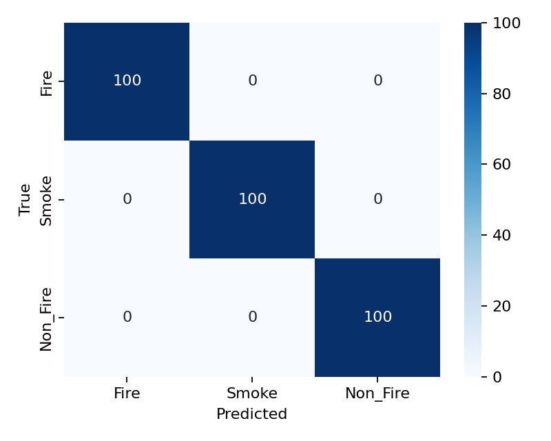

*Obrázok 10. Matica zámien na testovacích dátach pre vybraný beh CoAtNet-0 (M5, beh 3).*

<p align="right"><a href="#obsah">Späť na obsah</a></p>

---

## Doplnkové experimenty M1: augmentácia a rozmrazovanie

Základná konfigurácia M1 používa doplnkovú augmentáciu a postupné rozmrazovanie backbone. Dva samostatné behy skúmajú vplyv týchto rozhodnutí.

<a id="tbl-additional-m1-sk"></a>

**Tabuľka 10. Diagnostické experimenty M1 pre augmentáciu a fine-tuning backbone.**

| Konfigurácia M1 | Augmentácia | Rozmrazovanie backbone | Test accuracy | F1 macro | Validation loss | Epochy |
|---|---|---|---:|---:|---:|---:|
| Hlavný benchmark M1 | Flip, rotácia, color jitter a náhodný crop | Áno | Priemer 97,89 % | Priemer 97,89 % | - | - |
| Doplnkový beh 91 | Bez flipu, rotácie a color jitteru; náhodný crop zostal | Áno | 97,67 % | 97,67 % | 0,08099 | 11 |
| Doplnkový beh 92 | Úplná tréningová augmentácia | Nie | 94,33 % | 94,34 % | 0,11916 | 15 |

Výsledok behu 92 ukazuje jasné zhoršenie, ak ImageNet backbone zostane zmrazený. Beh bez doplnkovej augmentácie je blízko priemeru M1. Keďže v ňom zostal `RandomResizedCrop`, nejde o úplne neaugmentovanú konfiguráciu. Doplnkové konfigurácie sú jednotlivé diagnostické behy, nie úplná štatistická ablačná štúdia.

<a id="fig-m1-no-augmentation-sk"></a>
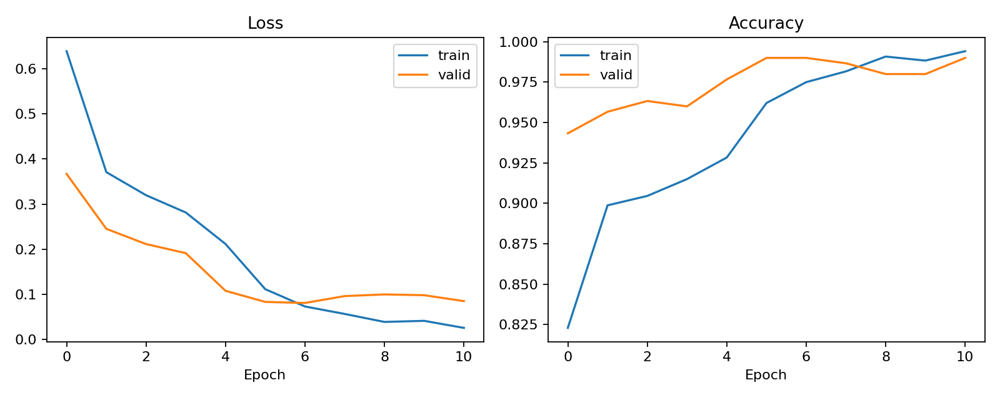

*Obrázok 11. Krivky učenia M1 bez doplnkového flipu, rotácie a color jitteru.*

<a id="fig-m1-frozen-sk"></a>
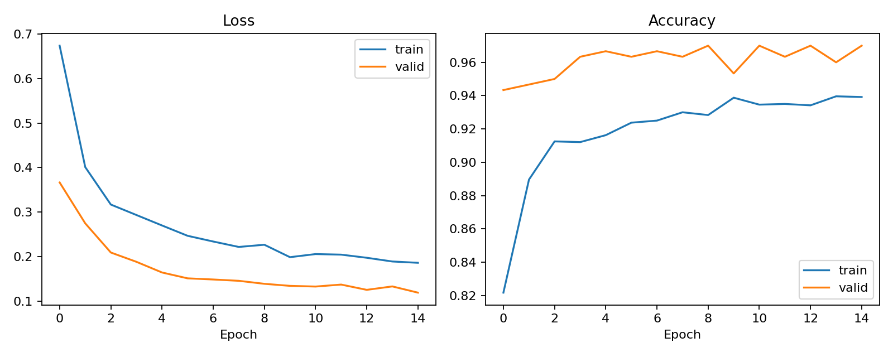

*Obrázok 12. Krivky učenia M1 so zmrazeným predtrénovaným backbone.*

<p align="right"><a href="#obsah">Späť na obsah</a></p>

---

## Grad-CAM vizualizácie

Grad-CAM bol vytvorený z poslednej konvolučnej vrstvy vhodných vybraných modelov. Pre jeden správne a, ak existuje, jeden nesprávne klasifikovaný testovací obrázok vytvára heatmapu prekrytú cez pôvodný obrázok.

- Červené a žlté oblasti mali najväčší pozitívny vplyv na predikovanú triedu.
- Zelené oblasti mali stredný vplyv.
- Modré oblasti mali malý vplyv.

Grad-CAM **nie je segmentačná maska**. Neoznačuje presne všetky pixely ohňa alebo dymu, ale ukazuje oblasti obrázka najdôležitejšie pre rozhodnutie modelu. M5 v behu 3 nemá obrázok nesprávnej klasifikácie, pretože správne klasifikoval všetkých 300 obrázkov hlavnej testovacej množiny.

<a id="fig-gradcam-correct-sk"></a>
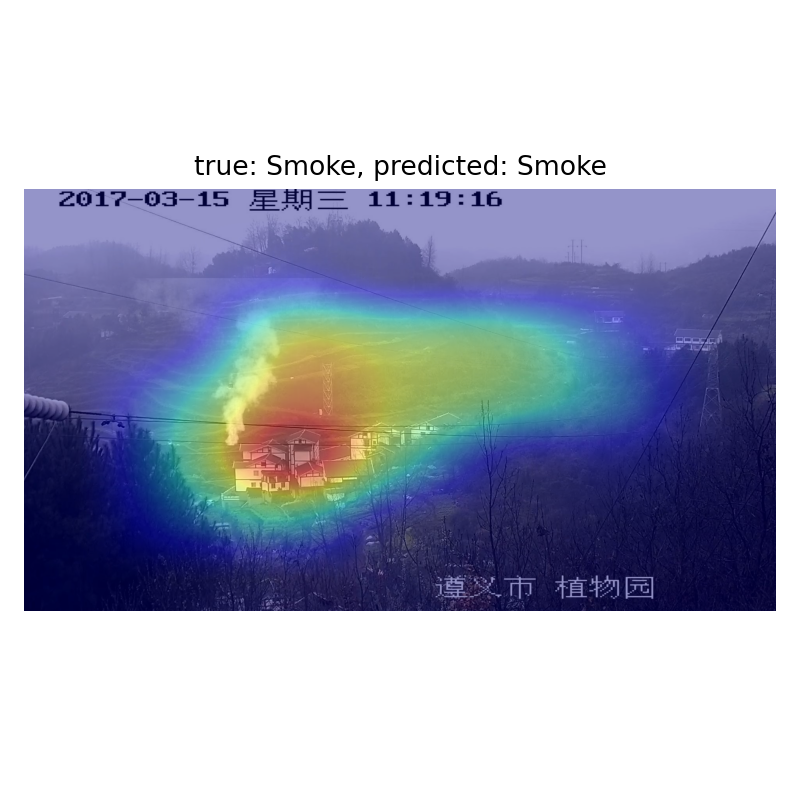

*Obrázok 13. Grad-CAM správne klasifikovaného testovacieho obrázka pre ResNet50 (M1, beh 3).*

<a id="fig-gradcam-incorrect-sk"></a>
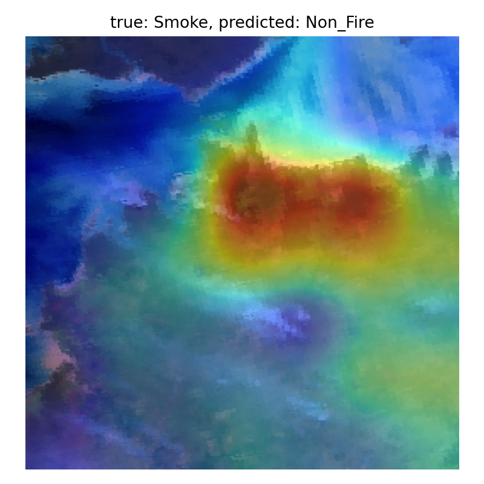

*Obrázok 14. Grad-CAM nesprávne klasifikovaného testovacieho obrázka pre ResNet50 (M1, beh 3).*

<p align="right"><a href="#obsah">Späť na obsah</a></p>

---

## Doplnkové hodnotenie na kompletných pôvodných testovacích dátach

Najlepší checkpoint M5 z hlavného porovnania (`M5_run3/weights.pt`) bol bez ďalšieho trénovania vyhodnotený na všetkých obrázkoch v pôvodných testovacích priečinkoch datasetu.

<a id="tbl-full-test-sk"></a>

**Tabuľka 11. Doplnkové hodnotenie M5 na kompletných dodaných testovacích priečinkoch.**

| Vlastnosť | Hodnota |
|---|---:|
| Model | M5 - CoAtNet-0, beh 3 |
| Počet obrázkov | 10 500 |
| Fire | 3 500 |
| Smoke | 3 500 |
| Non_Fire | 3 500 |
| Loss | 0,0545 |
| Accuracy | 98,33 % |
| Precision macro | 98,34 % |
| Recall macro | 98,33 % |
| F1 macro | 98,33 % |

Súvisiace súbory sú v `outputs/M5_full_test_final/`: `metrics.json`, `predictions.csv`, `original_test_manifest.csv` a `confusion_matrix.png`.

### Dôležitá interpretačná poznámka

Tento výsledok je užitočná rozsiahla doplnková kontrola, ale nemožno ho označiť za úplne nezávislé externé testovanie. Hlavné rozdelenie vzniklo skenovaním všetkých raw priečinkov vrátane pôvodných `test` priečinkov. Preto sa 733 obrázkov z pôvodných testovacích priečinkov už nachádzalo v hlavnej vzorke 3 000 obrázkov: 574 v train, 72 vo validation a 87 v hlavnej testovacej podmnožine. Hlavné výsledky na oddelenej množine 300 obrázkov zostávajú oficiálnym porovnaním, pretože všetky modely mali rovnaký protokol. Úplne nezávislé hodnotenie na pôvodných testovacích priečinkoch by vyžadovalo vytvoriť hlavné rozdelenie iba z pôvodných `train` priečinkov a všetky modely znovu natrénovať.

<a id="fig-m5-full-test-cm-sk"></a>


*Obrázok 15. Matica zámien M5 na všetkých 10 500 obrázkoch z dodaných pôvodných testovacích priečinkov.*

<p align="right"><a href="#obsah">Späť na obsah</a></p>

---

## Výstupy programu

Každé úplné spustenie vytvorí časovo označený priečinok v `outputs/`:

```text
outputs/<časová_značka>/
├── runs.csv                 # metriky všetkých behov
├── summary.csv              # priemer a smerodajná odchýlka M1-M5
├── best_runs.csv            # beh s najnižším validation loss pre každý model
├── report.md                # automaticky vytvorený experimentálny report
├── M1_run3/
│   ├── history.png          # trénovací/validačný loss a accuracy
│   ├── confusion_matrix.png # testovacia matica zámien
│   ├── test_predictions.csv
│   ├── gradcam_correct.png
│   ├── gradcam_incorrect.png
│   └── weights.pt
└── ...
```

Ak vybraný beh nemá nesprávnu predikciu, `gradcam_incorrect.png` sa nevytvorí.

<p align="right"><a href="#obsah">Späť na obsah</a></p>

---

## Inštalácia

Odporúča sa Python 3.10 alebo novší.

```powershell
python -m venv .venv
.\.venv\Scripts\Activate.ps1
pip install -r requirements.txt
```

Stiahnite a rozbaľte dataset pod `raw_data/`. Skript rekurzívne vyhľadáva priečinky tried `Fire`, `Smoke` a `Non_Fire`; pôvodné Kaggle priečinky `train` a `test` môžu zostať nezmenené.

```text
Forest-Fire-Classification/
├── raw_data/
│   └── FOREST_FIRE_SMOKE_AND_NON_FIRE_DATASET/
│       ├── train/
│       └── test/
└── experiment.py
```

Podporované formáty: JPG, JPEG, PNG, BMP, WEBP, TIF a TIFF.

<p align="right"><a href="#obsah">Späť na obsah</a></p>

---

## Spustenie

Vytvorenie iba rozdelenia dát:

```powershell
python experiment.py --prepare-only --samples-per-class 1000 --seed 42
```

Spustenie celého reportovaného benchmarku:

```powershell
python experiment.py --models M1 M2 M3 M4 M5 --runs 3 --epochs 15 --batch-size 8 --samples-per-class 1000
```

Rýchla kontrola prostredia:

```powershell
python experiment.py --models M1 --runs 1 --epochs 2 --batch-size 8 --samples-per-class 1000
```

Pre použitie všetkých dostupných obrázkov namiesto vyváženej vzorky 1 000 obrázkov na triedu použite `--samples-per-class 0`.

<p align="right"><a href="#obsah">Späť na obsah</a></p>

---

## Autori

**Ievgeniia Ievgrafova**  
**Yehor Kiriienko**

Projekt k predmetu Hlboké neurónové siete  
Fakulta elektrotechniky a informatiky  
Slovenská technická univerzita v Bratislave  
2026
